# NextITops ITSM & CMDB

**版本：v1.0.0.20261126**<br>
**分支：git-release**

NextITops 是一套轻量、现代、可私有化部署的 ITSM 与 CMDB 平台。它把配置管理、资产关系、IT 服务流程、监控告警和自定义报表放在同一个工作台中，适合希望快速落地 CMDB、事件/问题/变更管理、Zabbix 告警自动建单，又不想引入重型商业套件的团队。

本项目提供：

- 统一的 CI 资产模型、扩展字段、资产关系和资产拓扑
- 覆盖事件、问题、变更、审批、SLA 和自定义流程的 IT 服务管理
- Zabbix 7 告警接入、主机/软件/操作系统/MAC/硬件规格同步
- 关联资产查询、规则式自然语言查询、CSV 导出
- RBAC、密码策略、登录安全、审计日志、通知中心
- 浅色/深色导航、多套彩色主题、2K/4K 自适应界面

> 本分支为公开 release 分支。版本号 `v1.0.0.20261126` 

---

## 目录

- [1. 系统作用](#1-系统作用)
- [2. 功能与菜单说明](#2-功能与菜单说明)
- [3. 技术栈与架构](#3-技术栈与架构)
- [4. 开发环境部署](#4-开发环境部署)
- [5. 生产环境部署](#5-生产环境部署)
- [6. Zabbix 与 CI 数据来源配置](#6-zabbix-与-ci-数据来源配置)
- [7. API 配置与安全](#7-api-配置与安全)
- [8. 项目结构](#8-项目结构)
- [9. 备份、升级与故障排查](#9-备份升级与故障排查)
- [10. 相关文档](#10-相关文档)

---

## 1. 系统作用

### 1.1 定位：轻量、可持续演进的新一代 IT 管理平台

NextITops 不是一张静态的资产台账，也不是只能录入工单的表单系统，而是一套以 **CMDB 为数据底座、以 ITSM 为流程主线、以监控自动化为数据来源、以报表和拓扑为决策视图** 的轻量 IT 管理平台。

它面向希望快速落地 CMDB、事件/问题/变更管理、Zabbix 告警自动建单，又不想引入重型商业套件的团队。系统采用模块化单体架构，保持部署简单、升级可控、功能可持续迭代；从资产模型、关系模型到流程、字段、菜单、主题和 Logo 都可以按组织需要配置，而不是把业务硬编码在页面里。

核心设计原则：

- **一个数据底座**：服务器、虚拟机、网络设备、安全设备、存储、机柜、数据中心、操作系统、软件、业务系统等统一建模为 CI，使用同一套关系模型表达“安装、运行、承载、依赖、连接、归属”。
- **一条业务闭环**：以开源的Zabbix做为主机的监控层，自动发现主机和相关配置 → 资产清单同步 → 待确认主机人工归类 → 告警匹配 CI → 自动/人工建单 → 事件、问题、变更处理 → 审计与复盘。
- **一套可视化**：资产列表、CI 详情、关系拓扑、数据中心地图、机柜 U 位、告警态势和工作台统计共同呈现资产与业务影响。
- **一套治理能力**：RBAC、审批、审计、密码策略、登录安全、IP 限制、隐私协议和配置留痕，覆盖“谁能看、谁能改、谁审批、谁审计”。
- **可持续迭代**：数据库迁移、版本化构建、发布包、主题体系、可配置字段和菜单，使系统可以在不推翻既有数据的前提下持续增加能力。

### 1.2 基本框架

| 层次         | 主要能力                                                                                            |
| ------------ | --------------------------------------------------------------------------------------------------- |
| 资产模型层   | CI 类型、基础字段显示/隐藏、扩展字段、字段类型、必填与列表显示、资产编号/名称自动生成、生命周期状态 |
| 关系与拓扑层 | 关系类型、正反向名称、源/目标类型约束、上下游拓扑、业务影响分析、关系状态圆点、主机下线/删除联动    |
| 流程服务层   | 事件、问题、变更、审批、SLA、流程阶段、处理角色、通知、评论、附件、关联 CI、审计                    |
| 监控集成层   | Zabbix 7 API/Webhook、主机同步、MAC/OS/软件/CPU/内存/磁盘采集、待确认主机、类型映射、告警模拟、诊断 |
| 查询分析层   | 资产清单、关联资产查询、流程工单查询、规则式自然语言查询、动态字段、排序、分页、CSV 导出、模板      |
| 安全治理层   | 用户/角色/权限、三权分立式职责分离、登录锁定、密码策略、IP 白名单/黑名单、隐私协议、审计日志        |
| 体验配置层   | 浅色/深色导航、多套彩色主题、Logo/系统名称、登录页、菜单顺序、2K/4K 屏幕自适应                      |

### 1.3 CMDB 与 ITSM 的联动

CMDB 和 ITSM 不是两个孤立模块，而是同一条资产与服务的生命周期：

1. **监控发现资产**：Zabbix 同步主机、操作系统、软件、MAC 和硬件规格；未识别主机进入“待确认主机”，由人工确认类型后进入 CMDB。
2. **告警定位资产**：告警通过主机名、IP、标签匹配 CI；匹配成功后在告警中心展示关联资产，并按规则自动创建事件工单。
3. **工单关联资产**：事件、问题、变更都可以关联 CI；处理人能在工单中看到资产位置、负责人、业务归属和上下游关系。
4. **变更评估影响**：变更单关联 CI 后，可结合拓扑查看承载业务和依赖关系，降低“只改一台机器、影响一个业务”的风险。
5. **资产生命周期联动**：主机下线时，关联操作系统/软件在没有其他在线主机时自动转为“已下线”；主机删除时清理关系，并在没有其他在线主机时清理孤立 OS/软件资产。
6. **审计形成闭环**：资产变更、导入导出、审批、登录和权限变更均写入审计日志，便于复盘和责任追踪。

### 1.4 数据中心与机柜可视化

系统提供从“地理位置”（需要配置调用外部地图的API）到“机柜 U 位”的多层可视化，而不是只展示一张资产表格：

- **数据中心地图**：展示数据中心地理位置、网络连接状态、机柜/设备/业务数量和链路异常。
- **机柜视图**：按数据中心分组展示机柜容量、已用 U 位、设备上架情况和占用比例。
- **资产拓扑**：按网络、安全、存储、服务器、虚拟化、操作系统、软件/业务分层展示上下游关系，支持节点聚焦、类型隐藏、缩放和平移。
- **CI 详情**：除基础字段外，展示关系、网络端口、IP、MAC、负责人、生命周期和变更轨迹。

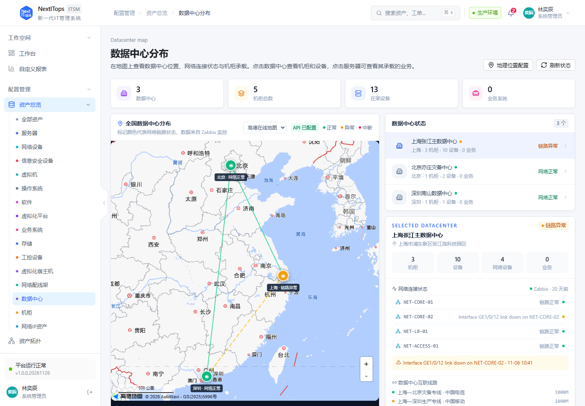

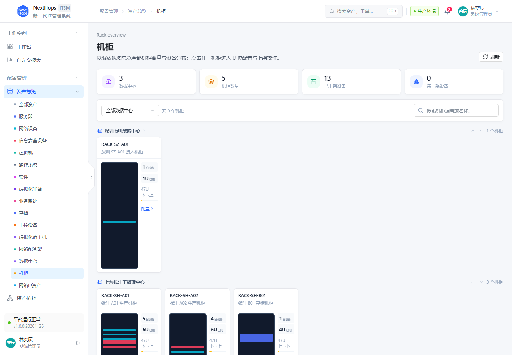

### 1.5 用户、角色与安全治理

系统内置系统管理员、IT 运维工程师、变更审批人、审计管理员、普通员工等角色，也可以按组织需要自定义角色和权限点。

在三权分立思路上，可将职责拆分为：

- **系统管理权**：维护 CI 模型、关系模型、流程、用户、集成和系统配置。
- **业务操作权**：处理资产、事件、问题、变更和告警，按角色限定可访问的菜单和数据。
- **审计监督权**：审计管理员默认只查看审计日志，不具备业务编辑权限；关键删除进入审批流程。

安全能力包括 JWT 会话、bcrypt 密码哈希、密码策略、登录失败锁定、IP 白名单/黑名单、隐私协议确认、敏感操作审计、生产环境 Nginx TLS、Node.js/数据库只监听本地地址。公开 release 分支不包含真实 API Key、数据库和运行日志，高德等第三方 Key 由部署方在系统中自行配置。

### 1.6 界面预览

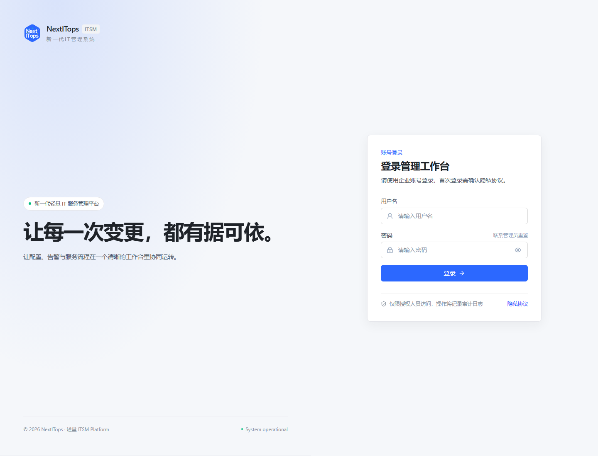

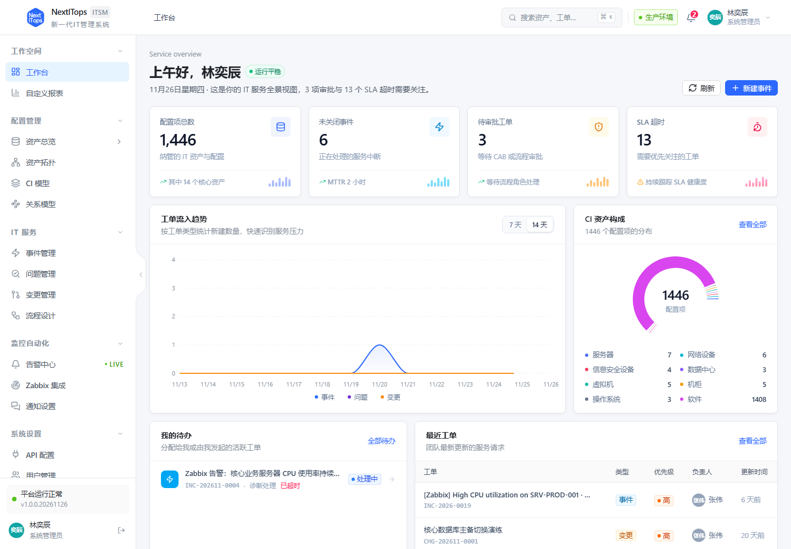

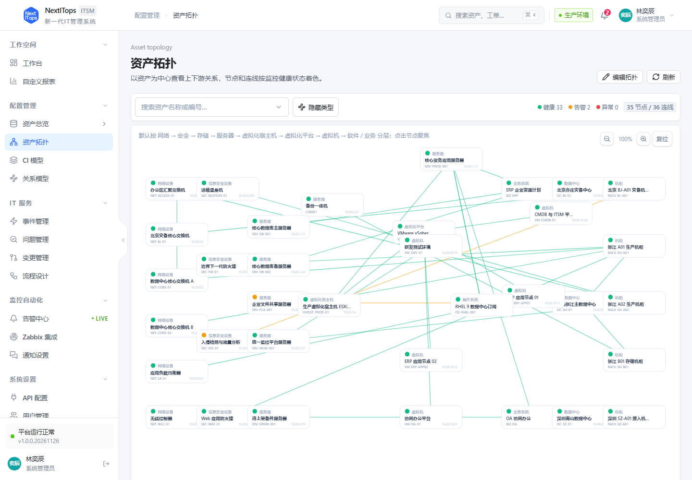

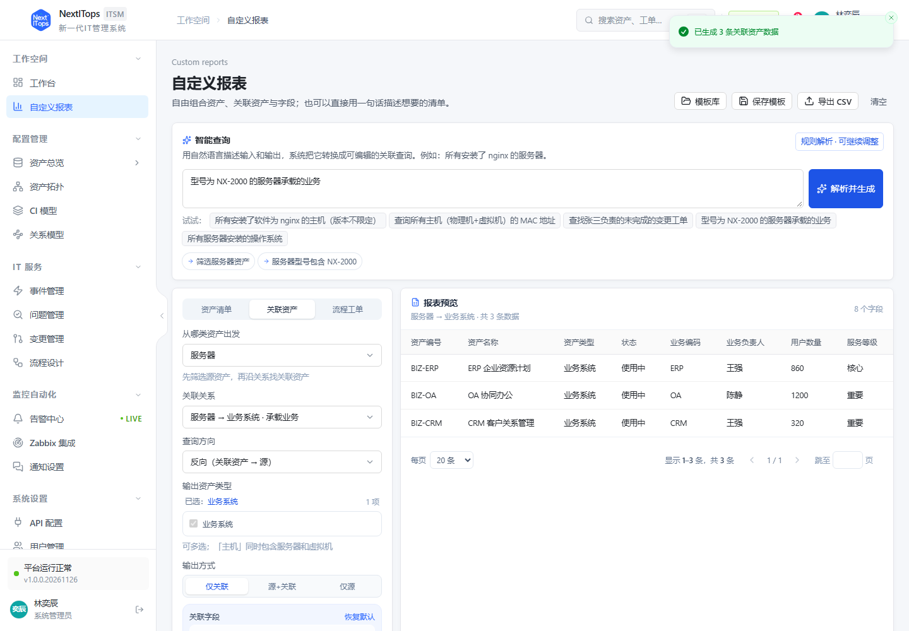

---

## 2. 功能与菜单说明

### 2.1 工作空间

| 菜单           | 功能                                                                                                                            |
| -------------- | ------------------------------------------------------------------------------------------------------------------------------- |
| **工作台**     | 资产总数、未关闭事件、待审批工单、SLA 超时、工单趋势、CI 类型分布、最近工单、Zabbix 实时告警、近期活动。支持 2K/4K 宽屏自适应。 |
| **自定义报表** | 三类查询：资产清单、关联资产、流程工单。支持字段勾选、筛选条件、排序、分页、CSV 导出、模板保存；支持规则式自然语言查询。        |

**智能查询示例**

- `所有安装了软件为 nginx，版本大于 1.20，同时操作系统为 CentOS7 的主机`
- `查找 IP 地址为 192.168.0.10 的主机`
- `查找张伟负责的未完成的变更工单`
- `型号为 NX-2000 的服务器承载的所有业务`
- 无法识别时会提示：`该自然语言本系统能力暂时不支持，建议用户自行定义搜索`

> 自然语言解析是规则解析，不调用外部大模型；解析结果会回填到可编辑的表单，用户可以继续调整。

### 2.2 配置管理

| 菜单         | 功能                                                                                                                                  |
| ------------ | ------------------------------------------------------------------------------------------------------------------------------------- |
| **资产总览** | 全部资产、各 CI 类型列表、资产详情、资产关系、扩展字段、导入导出、批量操作、删除审批。支持自定义字段排序、IP 分段排序、筛选条件保留。 |
| **资产拓扑** | 以资产为中心展示上下游关系和业务影响，支持缩放、平移、节点选中、编辑拓扑、隐藏类型、搜索定位。                                        |
| **CI 模型**  | 管理 CI 类型、基础字段显示/隐藏、扩展字段、字段类型、是否必填、是否在列表显示。隐藏字段在新建表单中不展示，也不再必填。               |
| **关系模型** | 管理关系类型、源/目标类型、正向/反向名称，支持 `安装软件`、`运行于`、`承载业务`、`安装操作系统` 等关系。                              |

**资产列表能力**

- 按类型、状态、重要性、负责人、环境、关键字筛选
- 自定义字段列排序
- 位置/IP 列按 IPv4 四段数值排序，避免 `192.168.6.x` 排在 `192.168.12.x` 后面
- 从详情返回列表时保留筛选条件；切换资产类型时清空关键字
- Excel 导入自动忽略与当前 CI 模型不匹配的多余列；缺少非核心列不阻断导入
- 资产编号/名称被模型隐藏时，系统自动生成唯一编号和默认名称

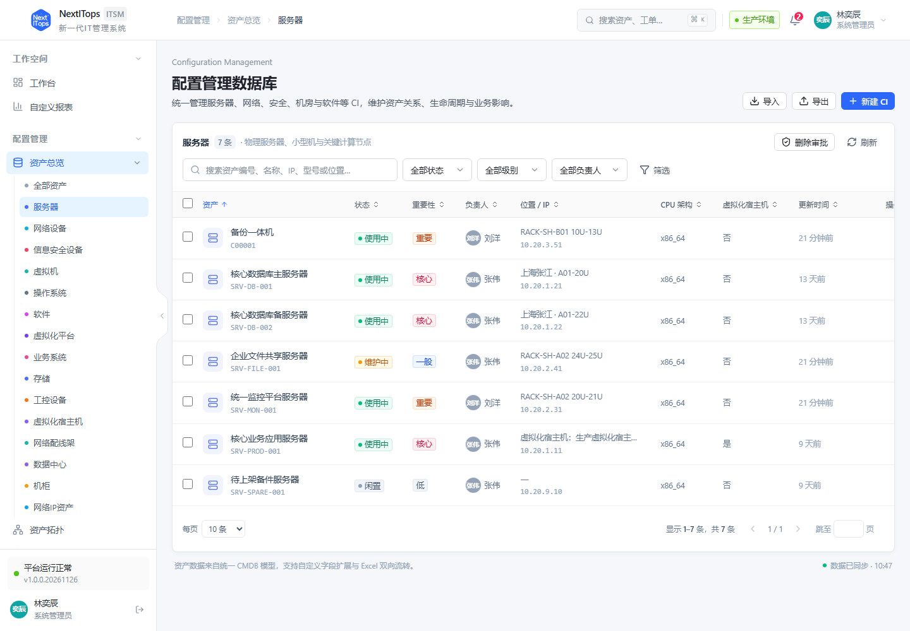

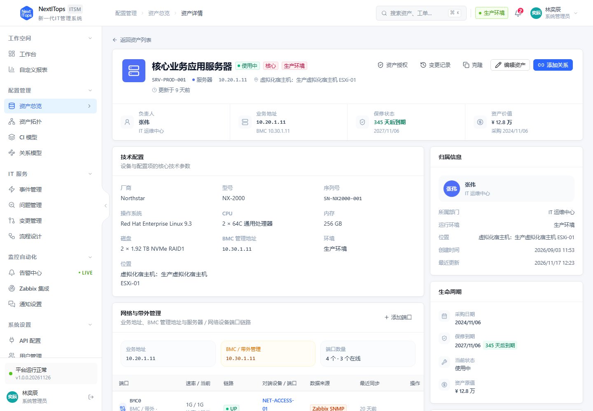

### 2.3 IT 服务

| 菜单         | 功能                                                                               |
| ------------ | ---------------------------------------------------------------------------------- |
| **事件管理** | 事件工单创建、分派、处理、解决、关闭；支持优先级、SLA、关联 CI、附件、评论、审计。 |
| **问题管理** | 问题登记、根因分析、关联事件/变更、解决方案和关闭。                                |
| **变更管理** | 变更申请、审批、实施、回滚记录、关联 CI 和风险等级。                               |
| **流程设计** | 自定义工单流程、状态、节点、审批角色和流转规则。                                   |

工单支持：

- 我的待办、全部工单、待审批、SLA 超时
- 请求人/负责人/处理人
- 关联 CI、关联告警、附件、评论、历史
- 通知渠道：站内、邮件、飞书、企业微信

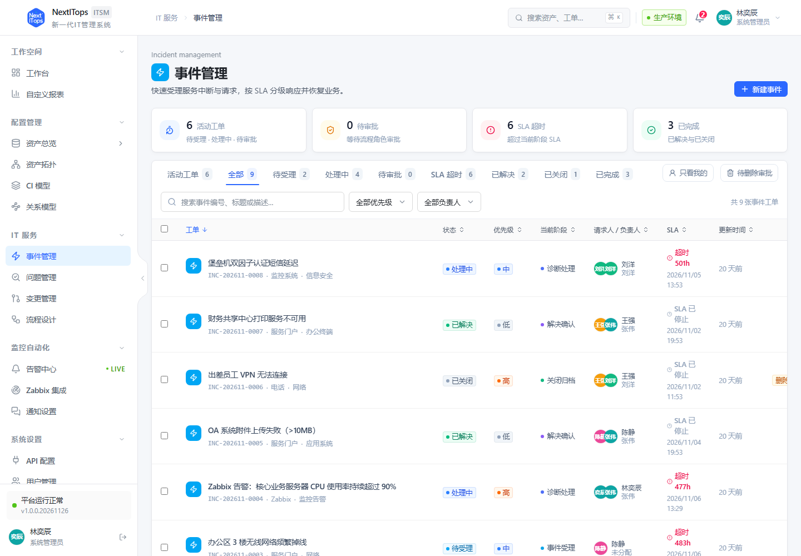

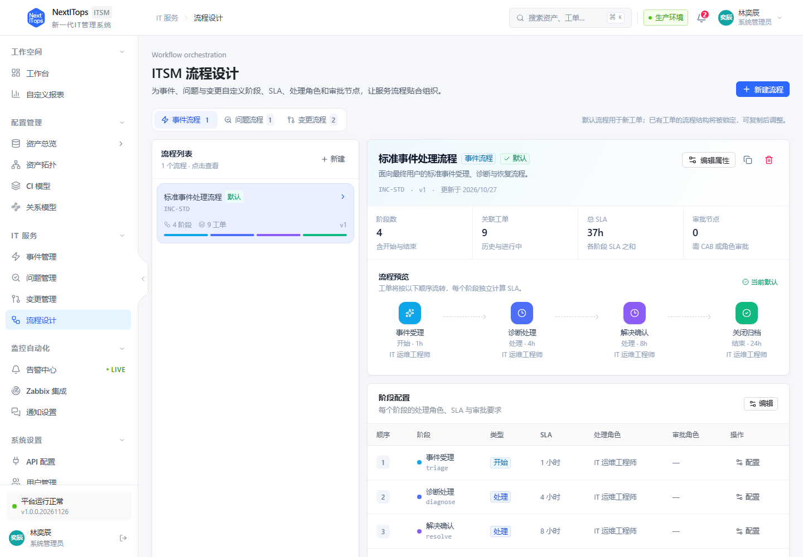

### 2.4 监控自动化

| 菜单            | 功能                                                                                                                           |
| --------------- | ------------------------------------------------------------------------------------------------------------------------------ |
| **告警中心**    | 告警态势、严重级别分布、事件流水、实时接收、告警详情、原始 Payload、自动建单状态。                                             |
| **Zabbix 集成** | Zabbix API 地址/Token、Webhook、主机同步、资产清单同步、软件/MAC/操作系统/硬件规格同步、待确认主机、告警模拟、诊断、过滤规则。 |
| **通知设置**    | SMTP、飞书机器人、企业微信机器人、通知日志、通知事件开关。                                                                     |

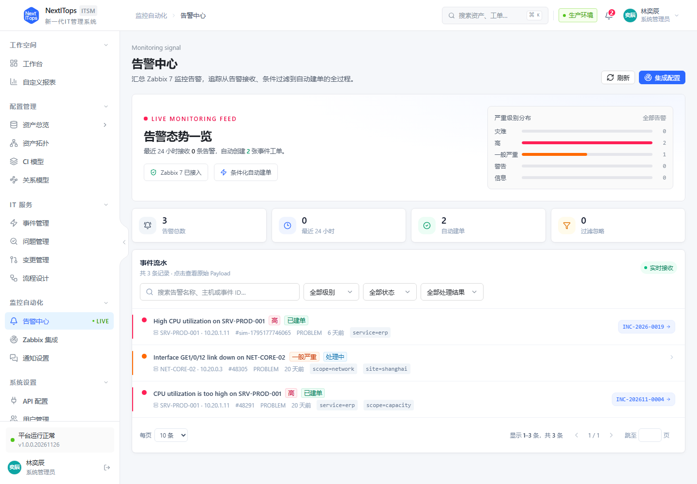

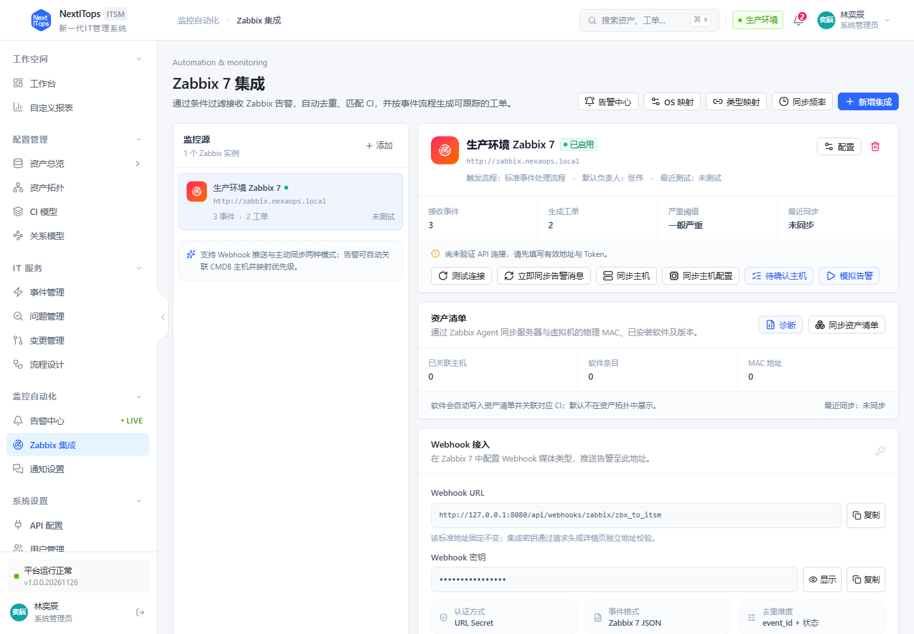

### 2.5 系统设置

| 菜单             | 功能                                                                   |
| ---------------- | ---------------------------------------------------------------------- |
| **API 配置**     | 高德地图 Web 服务 Key、JS API Key、安全密钥；Zabbix 等第三方集成入口。 |
| **用户管理**     | 用户、角色、部门、状态、头像、通知账号绑定。                           |
| **角色权限**     | RBAC 权限点、菜单权限、数据权限。                                      |
| **页面自定义**   | 系统名称、Logo、登录页文案、菜单顺序、侧栏宽度、主题默认值。           |
| **维护公告**     | 维护窗口、公告文案、顶部横幅。                                         |
| **隐私协议设置** | 隐私协议内容、首次登录确认、审计。                                     |
| **基础数据设置** | 状态、重要性、环境、工单类型等基础字典。                               |
| **审计日志**     | 登录、配置变更、资产操作、导入导出、审批等审计记录。                   |
| **关于系统**     | 版本、运行状态、数据库类型、安全基线、开源软件说明、发版里程碑。       |

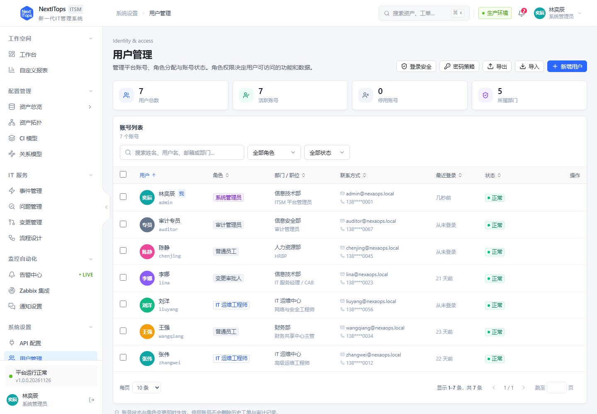

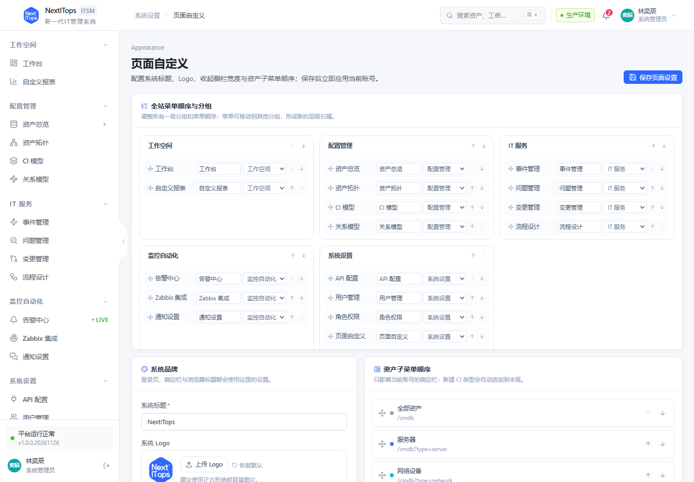

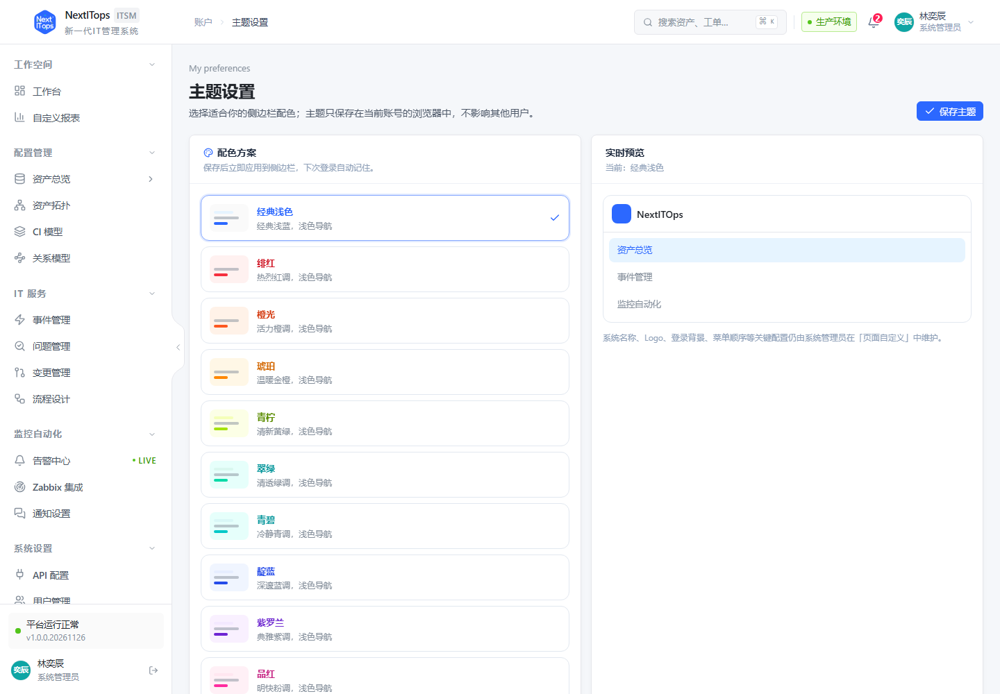

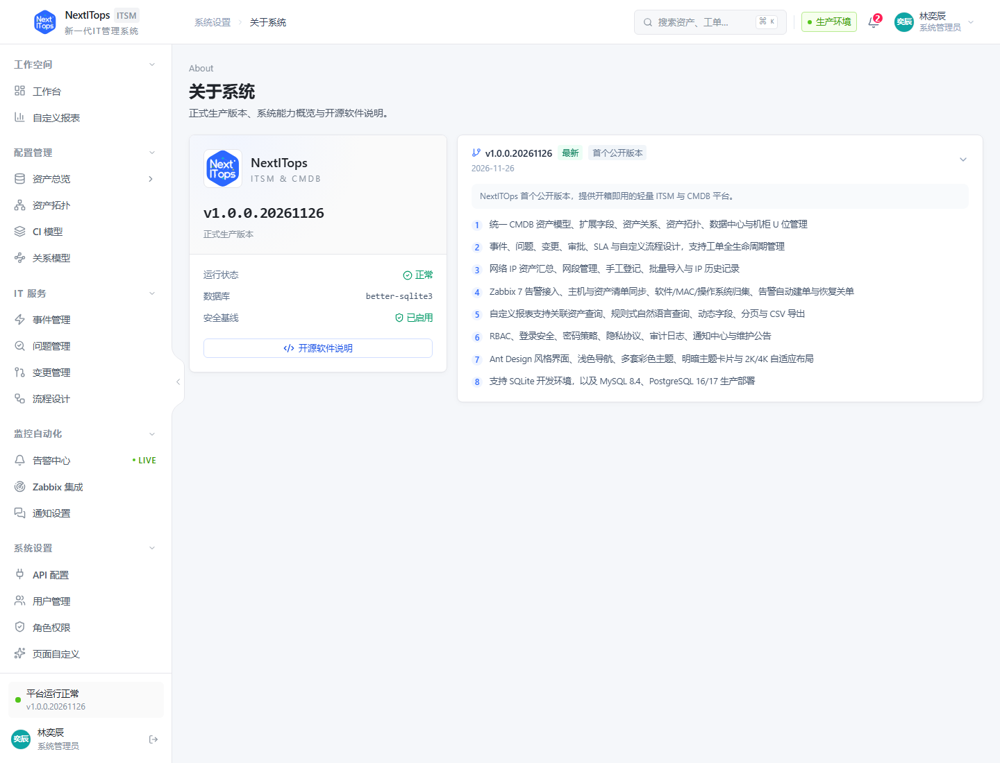

---

## 3. 技术栈与架构

| 层级   | 技术                                                                       |
| ------ | -------------------------------------------------------------------------- |
| 前端   | React 19、TypeScript 5.9、Vite 7、Tailwind CSS 4、React Router 7、Recharts |
| 后端   | Node.js 20.19+（推荐 24 LTS）、Fastify 5、Knex 3、Zod                      |
| 数据库 | 开发：SQLite；生产：MySQL 8.4 LTS 或 PostgreSQL 16/17（二选一）            |
| 文件   | ExcelJS（导入导出）、Nodemailer（SMTP）                                    |
| 认证   | JWT、bcryptjs、RBAC、登录失败锁定、密码策略                                |
| 监控   | Zabbix 7 API / Webhook                                                     |

**请求路径**

```text
浏览器
  └── Nginx (443, TLS)
        ├── /            → dist/ 静态资源
        └── /api/*       → Fastify 127.0.0.1:8080
                              ├── MySQL 127.0.0.1:3306
                              ├── 或 PostgreSQL 127.0.0.1:5432
                              └── Zabbix API / Webhook
```

生产环境只暴露 Nginx 的 80/443；Node.js 和数据库只监听 `127.0.0.1`。

---

## 4. 开发环境部署

### 4.1 环境要求

- Node.js **>= 20.19**，推荐 24 LTS
- pnpm **11.x**
- Git
- Windows/macOS/Linux 均可
- 开发数据库默认使用 SQLite，无需安装 MySQL/PostgreSQL

### 4.2 获取代码

```bash
git clone <your-repository-url> NextITops
cd NextITops
git switch git-release
```

### 4.3 安装依赖

```bash
corepack enable
corepack prepare pnpm@11.28.5 --activate
pnpm install
```

### 4.4 配置环境变量

```bash
cp .env.example .env
```

开发环境默认配置即可：

```ini
NODE_ENV=development
PORT=8080
HOST=0.0.0.0
APP_VERSION=1.0.0.20261126
JWT_SECRET=replace-with-a-long-random-secret
DB_CLIENT=better-sqlite3
DB_FILE=data/itsm.db
DATA_DIR=data
```

生产环境请务必替换 `JWT_SECRET`，并使用 MySQL 或 PostgreSQL 配置。

### 4.5 初始化开发数据库

```bash
pnpm seed
```

> `pnpm seed` 会重置并写入演示数据。不要对已有生产库执行。

### 4.6 启动开发环境

```bash
pnpm dev
```

启动后：

- 前端：<http://localhost:5173>
- API：<http://localhost:8080>
- 健康检查：<http://localhost:8080/api/health>

前端 Vite 会把 `/api` 代理到 `127.0.0.1:8080`。

### 4.7 默认账号

开发/演示数据默认账号：

| 账号      | 密码       | 说明       |
| --------- | ---------- | ---------- |
| `admin`   | `admin123` | 系统管理员 |
| `auditor` | `demo123`  | 审计管理员 |

**首次登录后立即修改默认密码。** 生产环境不要保留演示账号和演示数据。

### 4.8 常用命令

```bash
pnpm typecheck       # TypeScript 类型检查
pnpm build           # 构建前端到 dist/
pnpm start           # 以生产模式启动 Fastify
```

---

## 5. 生产环境部署

完整的加固、数据库、Nginx、systemd 和上线检查清单见 [`docs/PRODUCTION_DEPLOYMENT.md`](docs/PRODUCTION_DEPLOYMENT.md)。下面给出可直接执行的主流程。

### 5.1 准备服务器

推荐：

- Linux x64（Ubuntu 22.04/24.04、Debian 12、RHEL/Rocky/Alma 8.8+/9.2+、SUSE 15 SP5+）
- 4 vCPU / 8 GB 内存起
- Nginx 1.24+
- Node.js 24 LTS
- MySQL 8.4 LTS 或 PostgreSQL 16/17
- 启用 chrony/systemd-timesyncd
- 仅开放 80/443，SSH 限制来源 IP

以 Ubuntu/Debian 为例：

```bash
sudo apt update
sudo apt install -y curl ca-certificates gnupg lsb-release nginx chrony ufw
```

安装 Node.js 24（示例，具体以 NodeSource 官方仓库为准）：

```bash
curl -fsSL https://deb.nodesource.com/setup_24.x | sudo -E bash -
sudo apt install -y nodejs
sudo corepack enable
sudo corepack prepare pnpm@11.28.5 --activate
```

### 5.2 创建数据库

**MySQL 8.4：**

```sql
CREATE DATABASE NextITops
  CHARACTER SET utf8mb4
  COLLATE utf8mb4_0900_ai_ci;

CREATE USER 'NextITops'@'127.0.0.1'
  IDENTIFIED BY '替换为强密码';

GRANT ALL PRIVILEGES ON NextITops.* TO 'NextITops'@'127.0.0.1';
FLUSH PRIVILEGES;
```

**PostgreSQL 16/17：**

```sql
CREATE USER NextITops WITH PASSWORD '替换为强密码';
CREATE DATABASE NextITops
  OWNER NextITops
  ENCODING 'UTF8'
  LC_COLLATE='en_US.UTF-8'
  LC_CTYPE='en_US.UTF-8'
  TEMPLATE=template0;
```

数据库只监听 `127.0.0.1`，不要对公网开放。

### 5.3 创建运行用户与目录

```bash
sudo useradd --system --home /data/NextITops --shell /usr/sbin/nologin NextITops
sudo mkdir -p /data/NextITops /var/log/NextITops
sudo chown -R NextITops:NextITops /data/NextITops /var/log/NextITops
```

### 5.4 部署代码并构建

在构建机或生产机构建：

```bash
cd /data/NextITops
sudo -u NextITops git clone <your-repository-url> app
cd app
sudo -u NextITops git switch git-release
sudo -u NextITops pnpm install --frozen-lockfile
sudo -u NextITops pnpm typecheck
sudo -u NextITops pnpm build
```

生产机只运行 `dist/` 和 `server/`，不要暴露 `.env`、`.git`、源码映射文件。

### 5.5 配置 `.env`

```bash
cd /data/NextITops/app
sudo -u NextITops cp .env.example .env
sudo -u NextITops chmod 600 .env
```

**MySQL 示例：**

```ini
NODE_ENV=production
PORT=8080
HOST=127.0.0.1
APP_VERSION=1.0.0.20261126
JWT_SECRET=使用 openssl rand -base64 48 生成
JWT_EXPIRES_IN=12h
AUTO_SEED=false
LOG_LEVEL=info

DB_CLIENT=mysql2
DB_HOST=127.0.0.1
DB_PORT=3306
DB_NAME=NextITops
DB_USER=NextITops
DB_PASSWORD=替换为强密码
DB_SSL=false
DB_POOL_MAX=10

ZABBIX_TIMEOUT_MS=10000
ZABBIX_HOST_SYNC_MINUTES=5
```

**PostgreSQL 示例：**

```ini
DB_CLIENT=pg
DB_HOST=127.0.0.1
DB_PORT=5432
DB_NAME=NextITops
DB_USER=NextITops
DB_PASSWORD=替换为强密码
DB_SSL=false
DB_POOL_MAX=10
```

> `APP_VERSION` 用于页面和 `/api/health` 显示；不设置时后端回退到 `1.0.0.20261126`。

### 5.6 初始化空数据库

仅在**全新空库**执行一次：

```bash
cd /data/NextITops/app
sudo -u NextITops node scripts/production-init.mjs
```

该脚本会创建表结构、基础角色和必要字典。**不要对已有生产数据库执行。**

首次初始化后，立即登录并修改 `admin` 密码；按需删除演示账号、演示资产和演示工单。

### 5.7 配置 systemd

创建 `/etc/systemd/system/NextITops.service`：

```ini
[Unit]
Description=NextITops ITSM & CMDB
After=network.target mysql.service
Wants=mysql.service

[Service]
Type=simple
User=NextITops
Group=NextITops
WorkingDirectory=/data/NextITops/app
EnvironmentFile=/data/NextITops/app/.env
ExecStart=/usr/bin/node server/index.js
Restart=on-failure
RestartSec=5
NoNewPrivileges=true
PrivateTmp=true
ProtectSystem=full
ProtectHome=true
ReadWritePaths=/data/NextITops/app/data /var/log/NextITops

[Install]
WantedBy=multi-user.target
```

如使用 PostgreSQL，把 `After/Wants` 中的 `mysql.service` 改为 `postgresql.service`。

```bash
sudo systemctl daemon-reload
sudo systemctl enable --now NextITops
sudo systemctl status NextITops
```

### 5.8 配置 Nginx 与 HTTPS

`/etc/nginx/conf.d/NextITops.conf` 示例：

```nginx
limit_req_zone $binary_remote_addr zone=NextITops_login:10m rate=10r/m;

server {
    listen 80;
    server_name itsm.example.com;
    return 301 https://$host$request_uri;
}

server {
    listen 443 ssl http2;
    server_name itsm.example.com;

    ssl_certificate     /etc/nginx/certs/fullchain.pem;
    ssl_certificate_key /etc/nginx/certs/privkey.pem;
    ssl_protocols       TLSv1.2 TLSv1.3;

    root /data/NextITops/app/dist;
    index index.html;

    location / {
        try_files $uri $uri/ /index.html;
    }

    location /api/ {
        proxy_pass http://127.0.0.1:8080;
        proxy_http_version 1.1;
        proxy_set_header Host $host;
        proxy_set_header X-Real-IP $remote_addr;
        proxy_set_header X-Forwarded-For $proxy_add_x_forwarded_for;
        proxy_set_header X-Forwarded-Proto $scheme;
    }

    location = /api/auth/login {
        limit_req zone=NextITops_login burst=10 nodelay;
        proxy_pass http://127.0.0.1:8080;
    }

    location ~ /\.(env|git|map|sql|log) {
        deny all;
    }
}
```

```bash
sudo nginx -t
sudo systemctl reload nginx
```

### 5.9 上线检查

```bash
curl -fsS http://127.0.0.1:8080/api/health
```

预期返回：

```json
{
  "status": "ok",
  "version": "1.0.0.20261126",
  "database": "mysql2"
}
```

然后检查：

1. 访问 `https://itsm.example.com`，登录。
2. 「关于系统」显示 `v1.0.0.20261126` / 正式生产版本。
3. 右上角显示绿色「生产环境」标签。
4. 修改默认管理员密码。
5. 在「API 配置」中按需填写高德 Key；未配置时只影响在线地图。
6. 在「Zabbix 集成」中配置 Zabbix API 地址和 Token。
7. 执行一次主机同步和资产清单同步，确认待确认主机、软件、操作系统、MAC 数据正常。

---

## 6. Zabbix 与 CI 数据来源配置

Zabbix 是本系统依赖的底层的自动化数据源，但它只负责采集，最终数据会写入 CMDB 的 CI、关系和扩展字段。

### 6.1 在 NextITops 中配置 Zabbix

进入：

```text
监控自动化 → Zabbix 集成 → 新增集成
```

填写：

- **Zabbix API URL**：例如 `http://zabbix.example.com/api_jsonrpc.php`
- **API Token**：Zabbix 7 用户 API Token，建议使用只读 + 主机/监控项/历史读取权限
- **Webhook 地址**：NextITops 对外可访问的地址，例如 `https://itsm.example.com/api/webhooks/zabbix`
- **默认负责人/流程**：告警自动建单使用
- **同步间隔**：默认 5 分钟（`ZABBIX_HOST_SYNC_MINUTES`）

保存后点击「测试连接」，再执行「同步主机」。

### 6.2 主机类型与待确认

NextITops 只把 `server` / `vm` 类型的主机纳入资产清单同步。

主机类型来源优先级：

1. Zabbix 主机标签，例如 `cmdb.type=server`、`cmdb.type=vm`
2. Zabbix 主机组名称
3. Zabbix Inventory 的 `type` 字段

无法识别类型、缺少 IP 或信息冲突的主机会进入「待确认主机」。人工确认后，后续同步不会重复出现；已忽略的主机可在「已忽略」页恢复为待确认。

### 6.3 操作系统

推荐 Item：

| 数据                   | Item Key             | 说明     |
| ---------------------- | -------------------- | -------- |
| 操作系统名称           | `system.sw.os`       | 优先读取 |
| 操作系统名称（带名称） | `system.sw.os[name]` | 备用     |
| 内核/发行版            | `system.uname`       | 兜底     |

同步逻辑：

- 读取上述 Item 的文本值
- 映射为可读 OS 名称（如 `RHEL 9`、`Windows Server 2022`）
- 写入主机的 `os_name`
- 创建 `os_installed` 关系，目标为操作系统 CI
- 原始值保存在主机 `attributes.zabbix_os_raw`

如果 OS 资产不存在，系统会按映射后的名称创建；不会覆盖人工维护的 OS 字段。

### 6.4 软件清单

Linux：

- Item Key 以 `system.sw.packages.get` 开头
- 返回 JSON 数组，元素包含 `name` / `version`（或 `Name` / `Version`）
- Zabbix Item 类型使用「文本」，不要使用字符/日志类型

Windows：

- 使用 `registry.get[...Uninstall...]` 或自定义 UserParameter
- 返回 JSON 数组，元素包含 `DisplayName` / `DisplayVersion`（或 `name` / `version`）

注意：

- Zabbix 文本 Item 通常有 **64KB** 上限。
- 软件很多时，建议按包名前缀拆成多个 Item，每个 Item 仍以 `system.sw.packages.get` 开头，或 Windows 侧拆分多个 `registry.get[...Uninstall...]`。
- 系统会合并同一主机的多个软件 Item，去重后创建软件资产与 `software_installed` 关系。
- 单个 Item 被截断时会跳过并产生诊断告警，可在「资产清单诊断」中查看。

### 6.5 MAC 地址

Linux：

- `system.hw.macaddr[<接口>,full]` LLD
- 或返回包含 `mac` / `interface` 的 JSON 数组

Windows：

- `Win32_NetworkAdapter` 相关 Item
- 返回包含 `MACAddress` / `InterfaceDescription` 的 JSON 数组

系统会排除回环、全零、全 F 地址；只填充 CMDB 中为空的 MAC，不覆盖人工维护值。

### 6.6 CPU、内存、磁盘

| 数据     | Item Key                                                                   | 单位  |
| -------- | -------------------------------------------------------------------------- | ----- |
| CPU 核数 | `system.cpu.num` / `system.cpu.cores`                                      | 个    |
| 内存总量 | `vm.memory.size[total]`                                                    | bytes |
| 磁盘总量 | 所有 `vfs.fs.dependent.size[<分区>,total]` 之和（兼容 `vfs.fs.size[...]`） | bytes |

磁盘同步会排除 `/boot`、SWAP、tmpfs、proc、sysfs 等伪文件系统；Windows 的 `C:`、`D:` 等盘符会一并汇总。

### 6.7 告警 Webhook

在 Zabbix 中配置 Webhook 媒体类型：

- 地址：`https://itsm.example.com/api/webhooks/zabbix`
- 方法：POST
- 认证：按 NextITops 集成详情中的 Webhook 密钥配置
- Payload：Zabbix 7 JSON

NextITops 会：

- 解析触发器、主机、严重级别、标签
- 按过滤规则去重/过滤
- 自动创建事件工单
- 告警恢复后按规则自动关单
- 记录原始 Payload 和通知日志

### 6.8 资产清单诊断

进入：

```text
Zabbix 集成 → 资产清单 → 诊断
```

可查看：

- 每个主机的软件条目数、已关联数、缺少关联数
- 被 64KB 截断的 Item
- 资产类型异常
- 同步跳过的主机和原因

修复后重新执行「同步资产清单」，系统会补齐缺失关系，不会重复创建已有资产。

### 6.9 主机生命周期联动

- 主机（server/vm）下线时，关联 OS/软件如果没有其他在线主机关系，自动变为「已下线」
- 如果还有其他在线主机关联，OS/软件保持「使用中」，关系列表用绿色/灰色圆点显示主机在线状态
- 主机删除时自动删除关系；没有其他在线主机关系的 OS/软件资产同步删除
- 手工状态变更、批量操作、删除审批和 Zabbix 主机离线共用同一套规则

---

## 7. API 配置与安全

### 7.1 高德地图

进入：

```text
系统设置 → API 配置
```

填写：

- Web 服务 Key（可选，用于地址解析/逆地理编码）
- JS API Key（在线地图）
- 安全密钥（JS API 2.0）

说明：

- 本仓库不包含任何真实高德 Key。
- 不配置时只影响在线地图，不影响 CMDB、工单和资产清单。
- 生产环境建议给 Key 配置域名白名单，并限制调用配额。
- 服务端 Key 不要写入前端代码或公开仓库。

### 7.2 其他第三方

- Zabbix：在「Zabbix 集成」中配置，不写入 `.env`
- 飞书/企业微信机器人：在「通知设置」中配置
- SMTP：在「通知设置」中配置
- 所有密钥只保存在数据库或 `.env`，不要提交到 Git

### 7.3 安全建议

- 使用 HTTPS，启用 HSTS、CSP、`X-Content-Type-Options`、`X-Frame-Options`
- 数据库只监听 `127.0.0.1`
- `.env` 权限 600，禁止 Web 访问
- Nginx 拒绝 `.env`、`.git`、`.map`、`.sql`、`.log` 和隐藏文件
- 修改默认管理员密码，启用密码策略和登录限流
- 定期备份数据库和 `app/data`（头像、上传文件）
- 不要把 `dist` 的 sourcemap 或后端源码暴露到 Web 根目录

---

## 8. 项目结构

```text
.
├── server/                 # Fastify API、数据库、服务
│   ├── db/                 # schema、seed、连接
│   ├── lib/                # 认证、Excel、头像、审计、上传等
│   ├── routes/             # REST API
│   └── services/           # Zabbix、资产生命周期、通知等
├── web/                    # React 前端
│   ├── public/             # logo.svg、favicon.svg、地图资源
│   └── src/
│       ├── components/     # 布局、UI、地图、选择器
│       ├── context/        # 认证、品牌
│       ├── lib/            # API、类型、主题、工具
│       └── pages/          # 工作台、CMDB、工单、报表、系统设置
├── docs/                   # 部署、Zabbix、地图文档与界面截图
├── scripts/                # 生产初始化脚本
├── data/                   # 运行时数据（Git 忽略）
├── dist/                   # 前端构建产物（Git 忽略）
└── README.md
```

---

## 9. 备份、升级与故障排查

### 9.1 备份

必须备份：

- MySQL/PostgreSQL 数据库
- `app/.env`
- `app/data/`（SQLite、上传附件、头像）

示例：

```bash
BACKUP=/backup/NextITops-$(date +%Y%m%d%H%M%S)
mkdir -p "$BACKUP"
mysqldump --single-transaction -u NextITops -p NextITops > "$BACKUP/NextITops.sql"
cp -a /data/NextITops/app/.env "$BACKUP/.env"
cp -a /data/NextITops/app/data "$BACKUP/data"
```

### 9.2 升级

```bash
sudo systemctl stop NextITops
cd /data/NextITops/app
git fetch origin
git switch git-release
git pull --ff-only
pnpm install --frozen-lockfile
pnpm build
sudo systemctl start NextITops
```

升级前先备份。不要对已有数据库执行 `production-init.mjs` 或 `pnpm seed --reset`。

### 9.3 常见问题

| 问题            | 排查                                                                 |
| --------------- | -------------------------------------------------------------------- |
| 页面 404        | Nginx 是否配置 `try_files $uri $uri/ /index.html`                    |
| API 502         | Node 是否监听 8080；`systemctl status NextITops`；Nginx 代理地址     |
| 登录后立即退出  | `JWT_SECRET` 是否为空；系统时间是否准确；浏览器是否禁用 Cookie       |
| Zabbix 同步失败 | API URL/Token 权限；`item.get`、`history.get` 是否可用；网络是否可达 |
| 软件清单不完整  | 是否超过 64KB；是否拆分 Item；查看资产清单诊断                       |
| 在线地图空白    | 高德 JS Key/安全密钥/域名白名单是否正确                              |
| 头像上传失败    | 上传目录权限；反向代理 `client_max_body_size`；文件是否 ≤1MB         |

更多排查：

- [`docs/PRODUCTION_DEPLOYMENT.md`](docs/PRODUCTION_DEPLOYMENT.md)
- [`docs/ZABBIX.md`](docs/ZABBIX.md)
- [`docs/MAP.md`](docs/MAP.md)

---

## 10. 相关文档

- [生产部署与安全基线](docs/PRODUCTION_DEPLOYMENT.md)
- [Zabbix 接入与资产清单](docs/ZABBIX.md)
- [地图与高德配置](docs/MAP.md)

---

**NextITops v1.0.0.20261126**
让配置、告警与服务流程在一个清晰的工作台里协同运转。
